# Innovatech Solutions, sitio web: caso de estudio

Sitio web de una empresa que instala sistemas de seguridad y tecnología para hogares y negocios: cámaras, control de acceso, fibra óptica, redes, sonido y automatización del hogar.

Este repositorio es un caso de estudio. El código del sitio es privado; aquí se explica qué se hizo y cómo se ve.

Este sitio fue mi verdadera entrada al mundo del desarrollo.

## El objetivo

La empresa necesitaba un sitio que:

- Explicara sus servicios de forma separada para hogares y para empresas.
- Mostrara proyectos reales como prueba de su trabajo.
- Facilitara el contacto: formulario, teléfono, correo y WhatsApp.
- Estuviera en español y en inglés.
- Se viera bien en el celular, que es donde llega la mayoría de visitas.

## El sitio

### Inicio

Un carrusel de portada presenta los servicios principales y lleva a la sección correspondiente.

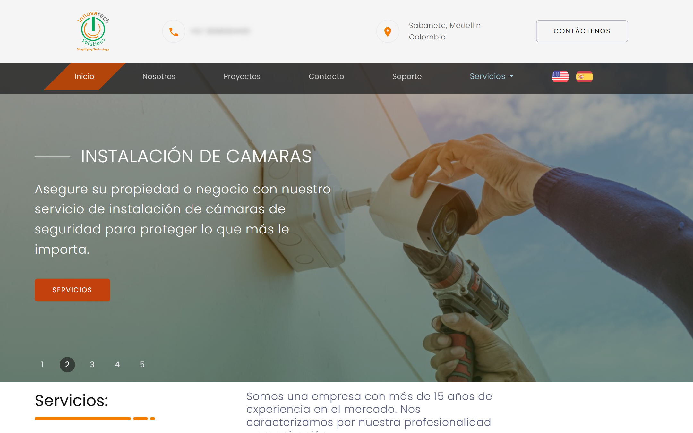

### Servicios

Los servicios están separados en dos páginas: residenciales (automatización del hogar, audio y video, iluminación) y comerciales (monitoreo en vivo, fibra óptica y redes, vigilancia).

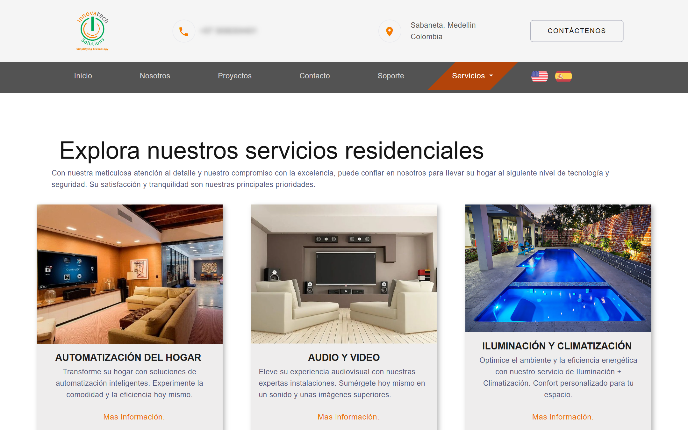

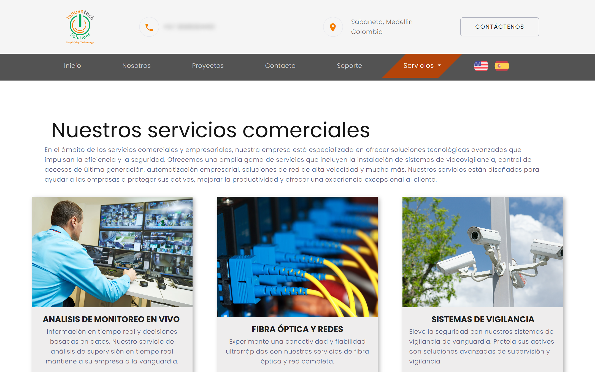

### Proyectos

Una página reúne los proyectos realizados, y cada uno tiene su propia página con fotos y la explicación del trabajo: cámaras de seguridad, control de acceso de vehículos, fibra óptica y sonido envolvente.

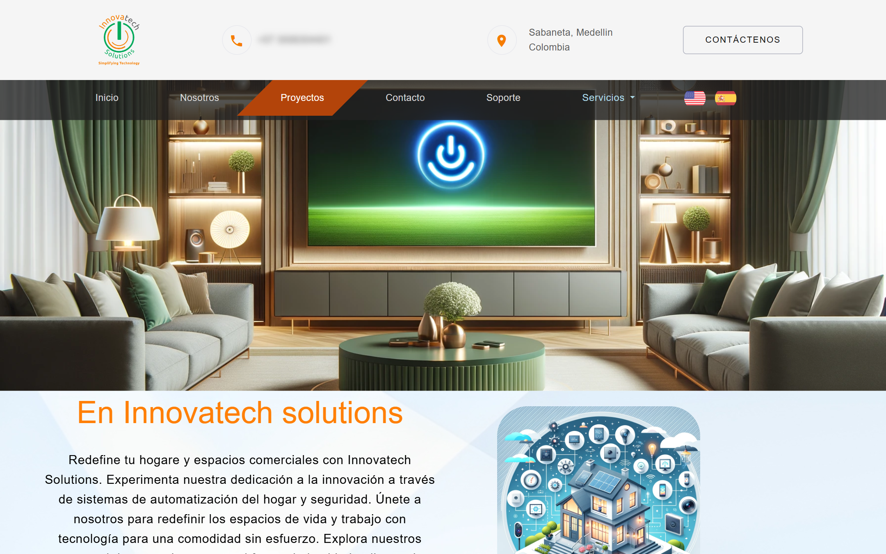

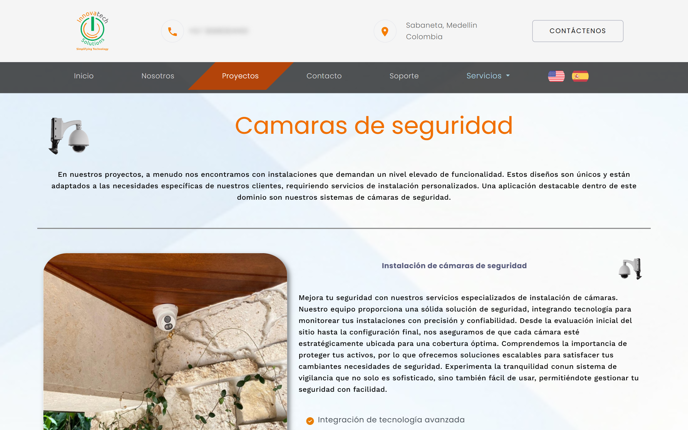

Así se ve completa, de arriba abajo, la página del proyecto de cámaras de seguridad:

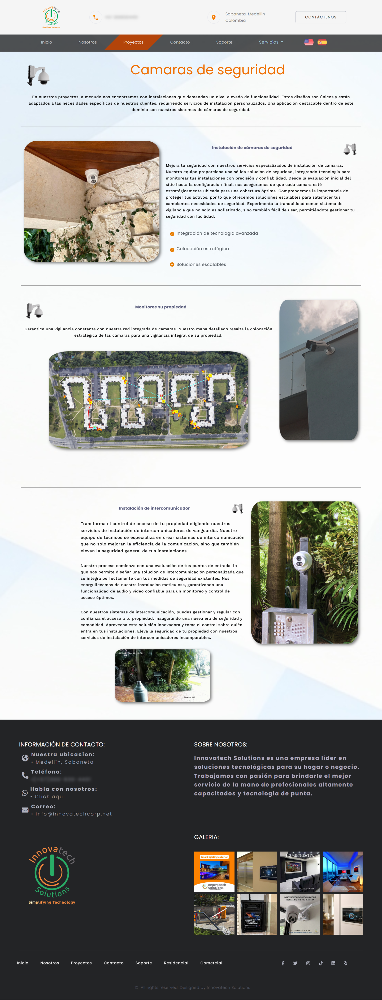

### Soporte y contacto

La página de soporte explica qué ayuda ofrece el equipo técnico. La de contacto tiene un formulario y los datos de la empresa.

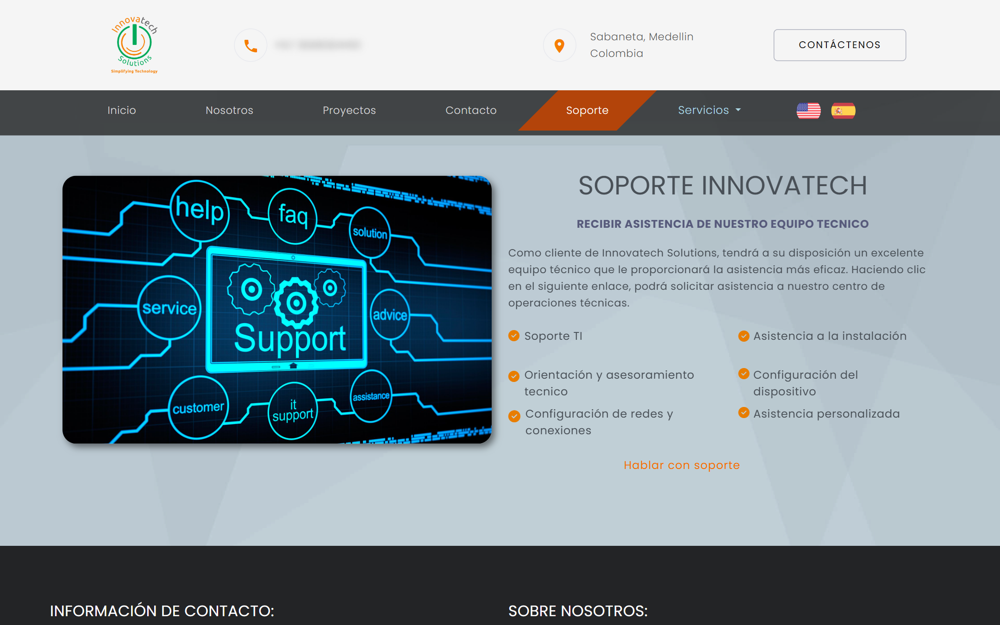

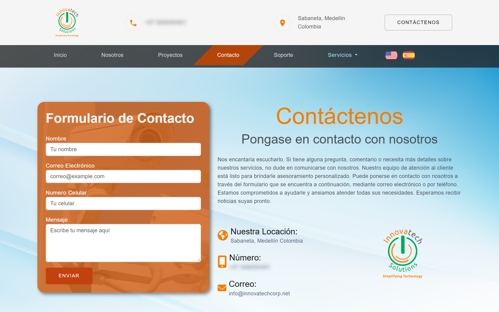

### En el celular

Todas las páginas se adaptan a pantallas pequeñas. El menú se convierte en un panel lateral que se abre desde el botón de la esquina.

| Inicio | Menú | Servicios | Contacto |
|---|---|---|---|
| 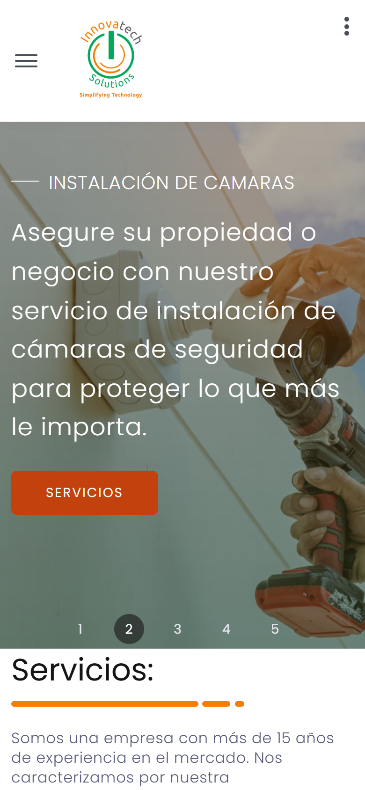 | 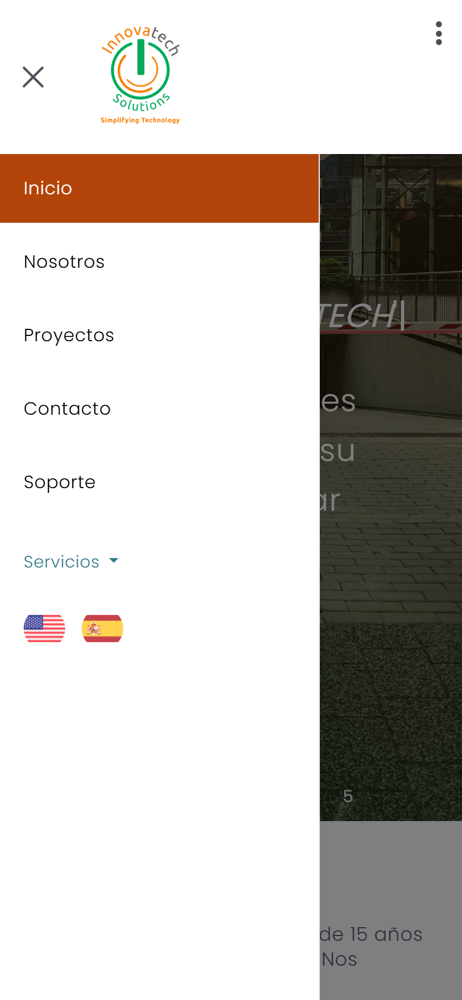 | 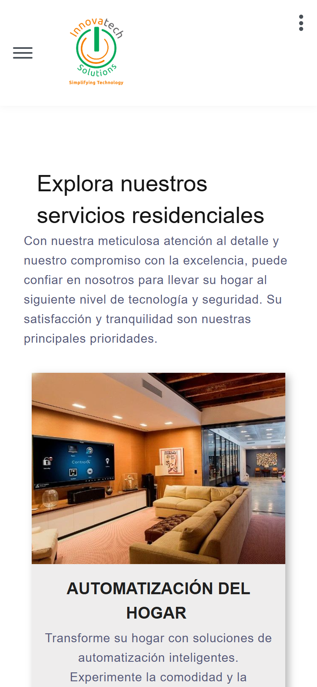 | 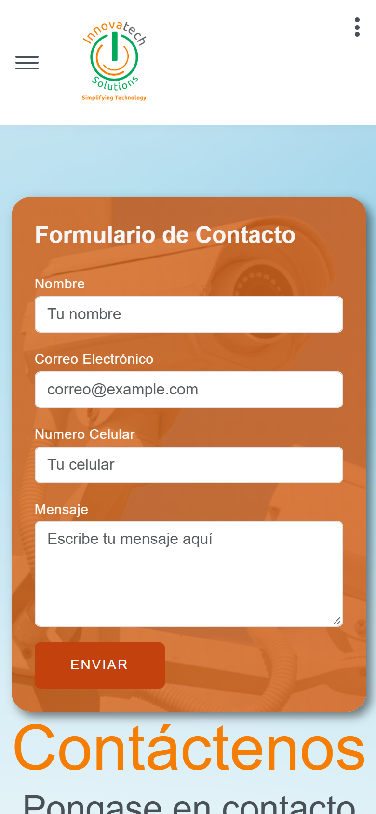 |

## Cómo está hecho

- HTML, CSS y JavaScript, sin framework. Cada página existe en español y en inglés, y el cambio de idioma se hace con las banderas del menú.
- Una plantilla base adaptada a la marca: colores, tipografía, menú y pie de página propios.
- Animaciones al hacer scroll y texto que se escribe solo en la portada.
- Formulario de contacto que envía el mensaje por correo con EmailJS, sin necesidad de un servidor propio.
- Pie de página compartido entre todas las páginas, para cambiar los datos de contacto en un solo lugar.
